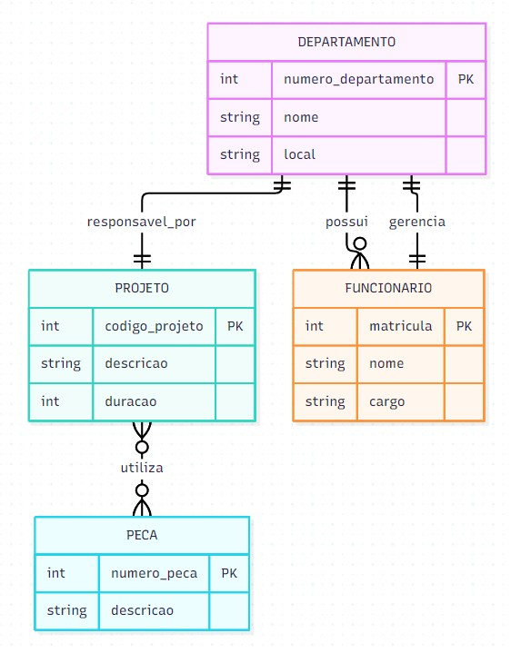

# Atividade - Diagrama Entidade-Relacionamento (DER)

## Objetivo
Desenvolver um Diagrama Entidade-Relacionamento para representar o controle de projetos desenvolvidos pelos departamentos de uma empresa[cite: 2].

---

## Entidades Identificadas

* **Departamento**
  * `numero_departamento` (PK)[cite: 2]
  * `nome`[cite: 2]
  * `local`[cite: 2]
* **Projeto**
  * `codigo_projeto` (PK)[cite: 2]
  * `descricao`[cite: 2]
  * `duracao`[cite: 2]
* **Funcionario**
  * `matricula` (PK)[cite: 2]
  * `nome`[cite: 2]
  * `cargo`[cite: 2]
* **Peca**
  * `numero_peca` (PK)[cite: 2]
  * `descricao`[cite: 2]

---

## Relacionamentos

| Entidade A | Relacionamento | Entidade B | Cardinalidade |
| :--- | :--- | :--- | :--- |
| Departamento | responsavel_por | Projeto | 1:1[cite: 2] |
| Departamento | possui | Funcionario | 1:N[cite: 2] |
| Funcionario | gerencia | Departamento | 1:1[cite: 2] |
| Projeto | utiliza | Peca | N:N[cite: 2] |

---

## Passo a Passo do Desenvolvimento

1. **Identificação das entidades:**
   * Foram identificadas as seguintes entidades: Departamento, Projeto, Funcionario e Peca[cite: 2].

2. **Identificação dos atributos:**
   * Foram definidos os atributos de cada entidade conforme informado no enunciado[cite: 2].

3. **Identificação dos relacionamentos:**
   * Os relacionamentos foram obtidos a partir das regras de negócio informadas[cite: 2].

4. **Definição das cardinalidades:**
   * Departamento $\leftrightarrow$ Projeto = 1:1[cite: 2]
   * Departamento $\leftrightarrow$ Funcionario = 1:N[cite: 2]
   * Funcionario $\leftrightarrow$ Departamento = 1:1[cite: 2]
   * Projeto $\leftrightarrow$ Peca = N:N[cite: 2]

---

## Diagrama DER

[cite: 2]

---

## Código Mermaid

O código estruturado para visualização em Mermaid encontra-se no arquivo `DER.mmd` neste repositório[cite: 1, 2].